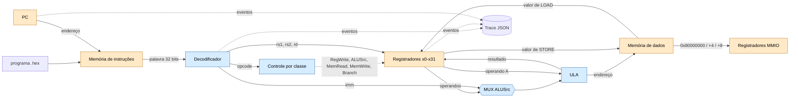

# Arquitetura do MiniRV

Fluxo: programa hexadecimal → memória de instruções → PC → decodificador → registradores/ULA →
memória de dados → trace.

**Legenda:** azul = bloco **combinacional** (a saída depende só das entradas atuais: decodificador,
controle, MUX e ULA); laranja = bloco com **estado** (PC, registradores e memórias).

## Mapa bloco → módulo

| Bloco | Tipo | Módulo | Semana |
| --- | --- | --- | --- |
| Palavra de 32 bits | — | `minirv/word32.py` | 03 |
| Portas, MUX, decoder 2→4, controle por classe | combinacional | `minirv/combinacional/` | 04 |
| Decodificador de instruções (spec do contrato) | combinacional | `minirv/decoder.py`, `minirv/isa.py` | 01, generalizado na 07 |
| Codificador de instruções | combinacional | `minirv/encoder.py` | 07 |
| Registradores, PC | sequencial | `minirv/registers.py`, `minirv/pc.py` | 01, 05 |
| ULA | combinacional | `minirv/alu.py` | 01, 05 |
| Memória de instruções / de dados | sequencial | `minirv/instruction_memory.py`, `minirv/data_memory.py` | 06 |
| MMIO (`0x80000000`, `+4`, `+8`) | estado de E/S | `minirv/data_memory.py` | mapa atual |
| Ciclo FETCH→WRITEBACK (instruções controladas) | controle | `minirv/executor.py` | 06 |
| CPU (19 instruções RV32I v1) | integração | `minirv/cpu.py` | execução |
| Aplicativo interativo do reatômetro | integração | `minirv/reatometro_app.py`, `programs/reatometro.s`, `programs/reatometro.hex` | MMIO |
| Trace | observação | `minirv/trace.py` | 01 |

## Escopo de execução

A memória de dados implementa os registradores MMIO `io_input` (`0x80000000`), `io_signal` (`0x80000004`)
e `io_cycles` (`0x80000008`), todos legíveis e graváveis. A CPU executa `ADD`, `ADDI`, `LUI`, `LW`, `SW`,
`BEQ`, `BNE`, `BLT`, `JAL`, `JALR`, `SUB`, `SLL`, `SLT`, `XOR`, `SRL`, `OR`, `AND`, `ORI` e `ANDI`,
completando as 19 instruções definidas no contrato. Instruções fora desse subconjunto continuam explicitamente
não suportadas. O aplicativo pode ser iniciado com `python -m minirv.reatometro_app`.

No aplicativo, cada instrução executada corresponde a um ciclo simulado. O contador de ciclos da reação é a
diferença de `instruction_count` durante o intervalo entre ativar o sinal MMIO e receber Enter; o Assembly
mantém em `x3` o número de iterações do laço e grava esse valor no registrador MMIO de ciclos. O executor
didático da Semana 06 permanece separado.
