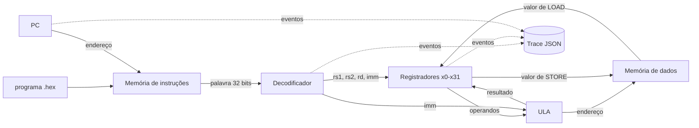

# Arquitetura do MiniRV

Fluxo: programa hexadecimal → memória de instruções → PC → decodificador →
registradores/ULA → memória de dados → trace.

Estado atual (Semana 01): memória de instruções e de dados ainda não existem como
módulos próprios; a CPU mantém a lista de palavras do programa e o PC internamente.
A memória de dados é prevista para a Semana 06. Os blocos que ainda não existem estão
no diagrama porque fazem parte da arquitetura-alvo.
