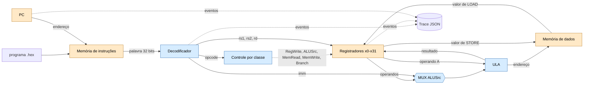

# Arquitetura do MiniRV

Fluxo: programa hexadecimal → memória de instruções → PC → decodificador → registradores/ULA →
memória de dados → trace.

**Legenda:** azul = bloco **combinacional** (a saída depende só das entradas atuais: decodificador,
controle, MUX e ULA); laranja = bloco com **estado** (PC, registradores e memórias).

## Mapa bloco → módulo

| Bloco | Tipo | Módulo | Semana |
| --- | --- | --- | --- |
| Palavra de 32 bits | — | `minirv/word32.py` | 03 |
| Portas, MUX, decoder 2→4, controle por classe | combinacional | `minirv/combinacional/` | 04 |
| Decodificador de instruções (spec do contrato) | combinacional | `minirv/decoder.py`, `minirv/isa.py` | 01, generalizado na 07 |
| Codificador de instruções | combinacional | `minirv/encoder.py` | 07 |
| Registradores, PC | sequencial | `minirv/registers.py`, `minirv/pc.py` | 01, 05 |
| ULA | combinacional | `minirv/alu.py` | 01, 05 |
| Memória de instruções / de dados | sequencial | `minirv/instruction_memory.py`, `minirv/data_memory.py` | 06 |
| Ciclo FETCH→WRITEBACK (instruções controladas) | controle | `minirv/executor.py` | 06 |
| CPU ADD/ADDI com trace por instrução | integração | `minirv/cpu.py` | 01 |
| Trace | observação | `minirv/trace.py` | 01 |

## O que ainda não existe

A CPU decodifica as 19 instruções do contrato, mas executa só `ADD` e `ADDI`; o executor da Semana 06 roda
apenas as três instruções controladas didáticas. O caminho de dados completo e o montador não fazem parte dos
documentos recebidos (ver `docs/checklist-final.md`).
