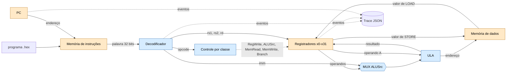

# Arquitetura do MiniRV

Fluxo: programa hexadecimal → memória de instruções → PC → decodificador → registradores/ULA →
memória de dados → trace.

**Legenda:** azul = bloco **combinacional** (a saída depende só das entradas atuais: decodificador,
controle, MUX e ULA); laranja = bloco com **estado** (PC, registradores e memórias).

## Mapa bloco → módulo

| Bloco | Tipo | Módulo | Semana |
| --- | --- | --- | --- |
| Palavra de 32 bits | — | `minirv/word32.py` | 03 |
| Portas, MUX, decoder 2→4, controle por classe | combinacional | `minirv/combinacional/` | 04 |
| Decodificador de instruções | combinacional | `minirv/decoder.py` | 01 (generalizado na 07) |
| Registradores, PC | sequencial | `minirv/registers.py`, `minirv/pc.py` | 01, 05 |
| ULA | combinacional | `minirv/alu.py` | 01, 05 |
| Memórias de instruções e de dados | sequencial | a criar (Semana 06) | 06 |
| Trace | observação | `minirv/trace.py` | 01 |

Estado atual: o PC e a lista de palavras do programa ainda ficam dentro de `cpu.py` e o módulo `pc.py` e as
memórias ainda não existem; eles entram nas Semanas 05 e 06. O diagrama mostra a arquitetura-alvo.
