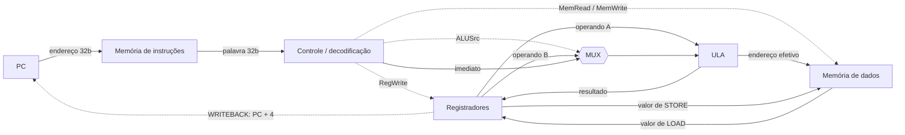
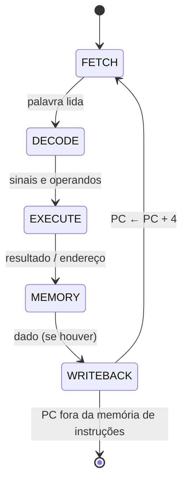

# Diagrama do ciclo de instrução (Semana 06)

Fonte editável em texto (Mermaid), versionada junto; o GitHub a renderiza como imagem.
Os cinco estados são uma decomposição didática, **não um pipeline**.

Setas contínuas = endereço e dados; tracejadas = sinais de controle.
